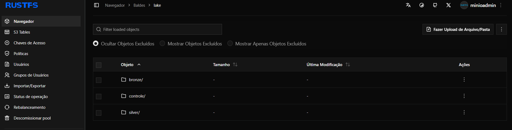
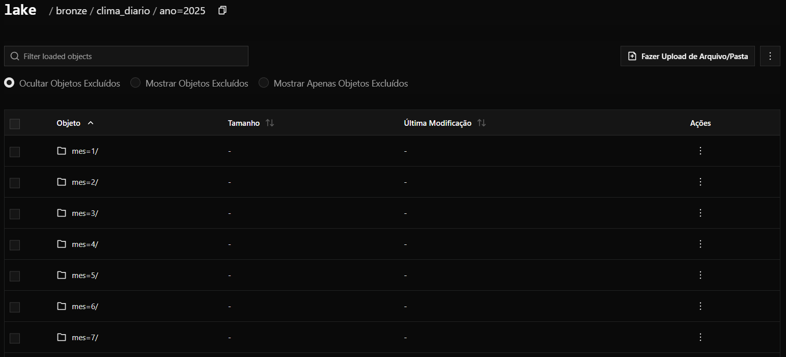
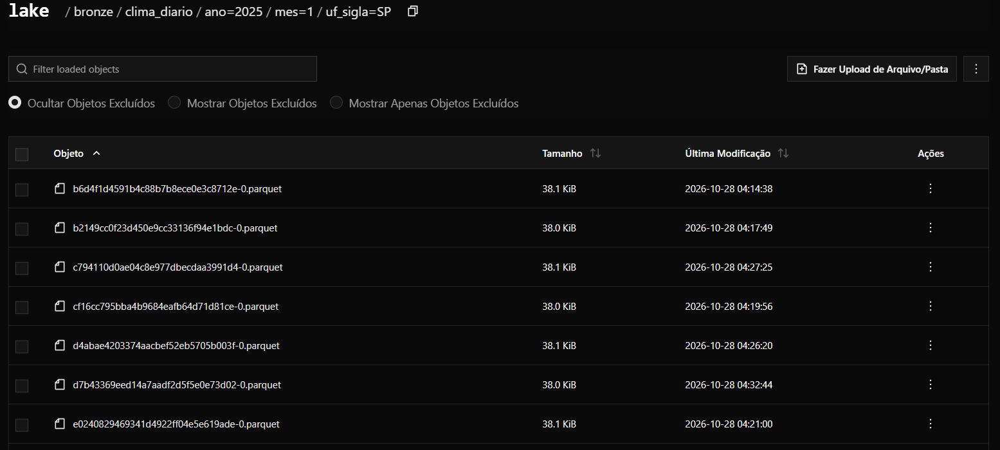
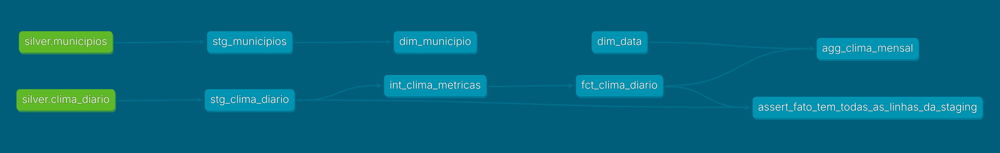
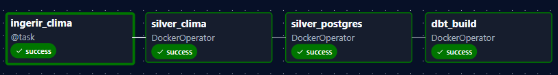
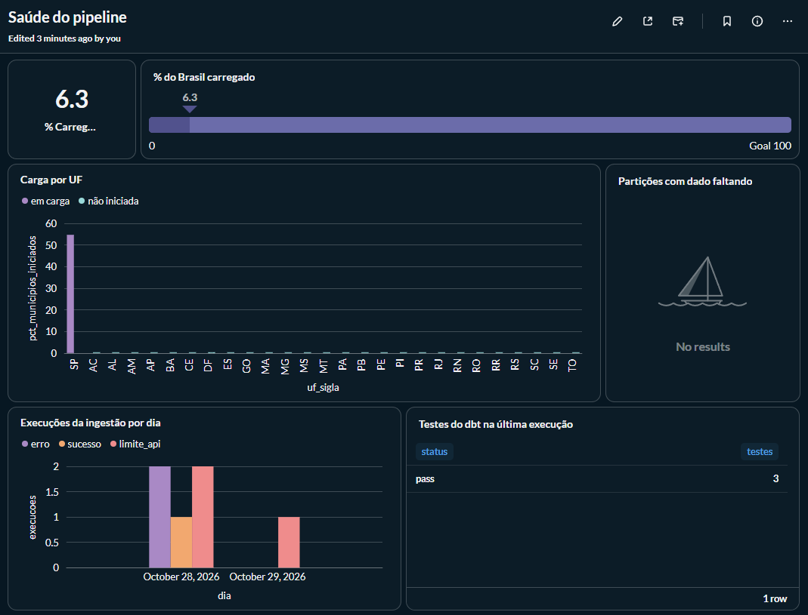

# brazil-weather-pipeline

Pipeline de engenharia de dados de ponta a ponta com o clima diário de todos os municípios brasileiros desde 2025 ([Open-Meteo](https://open-meteo.com/) + IBGE), do data lake ao dashboard e à previsão de temperatura.

```
Fontes (Open-Meteo, IBGE) → Bronze (RustFS, Parquet) → Silver (PySpark) → Gold (dbt + Postgres) → Metabase
                    └──────────────── orquestrado pelo Airflow ────────────────┘
```

## Status

| Fase | Entregável | Status |
| --- | --- | --- |
| 1. Fundação | Ambiente sobe com um comando | ✅ |
| 2. Ingestão bronze | Dados brutos no lake, carga incremental | ✅ código pronto (carga dos dados em andamento) |
| 3. Silver com PySpark | Tabelas limpas + comparativo de performance | ✅ |
| 4. Modelagem com dbt | Modelo dimensional testado | ✅ |
| 5. Orquestração com Airflow | Pipeline diário automático | ✅ |
| 6. Qualidade e observabilidade | Painel de saúde do pipeline | ✅ |
| 7. Consumo | Dashboards + previsão de temperatura | ⏳ |
| 8. CI/CD e documentação | Repositório com cara de produção | ⏳ |

## Stack

| Camada | Ferramenta |
| --- | --- |
| Infra | Docker Compose |
| Data lake | RustFS (S3 local) |
| Processamento | PySpark 3.5.6 (em container Docker) |
| Warehouse | Postgres 16 |
| Transformação | dbt 1.10 (em container Docker) |
| Orquestração | Apache Airflow 3 (LocalExecutor) |
| BI | Metabase |
| Qualidade de código | ruff, pre-commit, pytest |

## Como rodar

Pré-requisitos: Docker Desktop, Python 3.11+ e Git.

```bash
# 1. Variáveis de ambiente
copy .env.example .env      # Windows (Linux/Mac: cp .env.example .env); depois troque as senhas e o AIRFLOW_JWT_SECRET

# 2. Ambiente Python local (lint, testes, notebooks)
python -m venv .venv
.venv\Scripts\activate      # Windows  (Linux/Mac: source .venv/bin/activate)
pip install -r requirements-dev.txt
pre-commit install

# 3. Construir as imagens (1ª vez) e subir tudo
docker compose build
docker compose build spark dbt
docker compose up -d
docker compose ps           # aguarde todos ficarem "healthy"
```

| Serviço | Endereço | Acesso |
| --- | --- | --- |
| Airflow | http://localhost:8080 (ou a `AIRFLOW_PORT` do `.env`) | sem login (modo dev) |
| RustFS console | http://localhost:9001 | `LAKE_ACCESS_KEY` / `LAKE_SECRET_KEY` |
| Metabase | http://localhost:3000 | conta criada no primeiro acesso |
| Postgres | `localhost:5432` | `WAREHOUSE_USER` / `WAREHOUSE_PASSWORD` |

**Verificação:** no Airflow, ative e dispare a DAG `smoke_test`. Ela confirma a conexão com o Postgres e com o lake.

Com `make` instalado (Git Bash/WSL): `make setup`, `make up`, `make down`, `make lint`, `make test`, `make help`.

## Ingestão

Com o ambiente no ar (`docker compose up -d`) e o `.venv` ativo:

```bash
python -m ingestion.municipios   # tabela de municípios → s3://lake/bronze/municipios/
python -m ingestion.clima --uf SP --limite 3   # teste: clima de 3 cidades de SP
python -m ingestion.clima --uf SP              # clima de SP: busca só o que falta (incremental)
python -m ingestion.clima --uf SP --reprocessar --inicio 2025-03-01 --fim 2025-03-31  # refaz um período
pytest -q                        # testes, sem precisar de internet nem do lake
```

### Como os dados ficam no lake

O bucket `lake` tem uma pasta por camada: `bronze/` (dado bruto da API), `silver/` (dado limpo pelo Spark) e `controle/` (o log de cada carga).



O bronze é particionado por ano, mês e UF (`ano=2025/mes=1/uf_sigla=SP/`). Quem lê só um mês ou um estado não precisa abrir o resto.



Dentro de cada partição há um arquivo Parquet por lote de carga, com nome aleatório (uuid). Isso é proposital: o bronze é *append-only*. Cada carga acrescenta um arquivo novo e nunca sobrescreve as anteriores, então duas cargas ao mesmo tempo não se atropelam e uma carga que falhe no meio não corrompe o que já existia. A deduplicação fica para a silver.



## Spark

O Spark roda num container Docker, sob demanda (não sobe com `docker compose up`). A imagem é a oficial do Apache Spark com os conectores do S3 (para o lake) e do Postgres.

```bash
docker compose build spark                                   # 1ª vez: constrói a imagem
docker compose run --rm spark                                # job de teste: lê o bronze do lake
docker compose run --rm spark /opt/spark/bin/spark-submit teste_bronze.py   # o mesmo, explícito
docker compose run --rm spark /opt/spark/bin/pyspark         # PySpark interativo
docker compose run --rm spark /opt/spark/bin/spark-submit silver_clima.py                  # silver: só o que mudou
docker compose run --rm spark /opt/spark/bin/spark-submit silver_clima.py --modo completo  # silver inteira
docker compose run --rm spark /opt/spark/bin/spark-submit silver_postgres.py               # silver → Postgres (schema silver)
docker compose run --rm spark /opt/spark/bin/spark-submit --driver-memory 4g benchmark.py # pandas × PySpark → docs/benchmark/
```

Os jobs ficam em `spark/jobs/` e são editados normalmente no VS Code: a pasta é montada dentro do container.

### Comparativo de performance

Resultados do benchmark pandas × PySpark (mesma transformação da silver, ponta a ponta, e o ganho do particionamento) em [docs/benchmark/README.md](docs/benchmark/README.md).

## dbt

O dbt roda num container, sob demanda, e lê a silver do Postgres. Os modelos SQL ficam em `dbt/models/` e são editados normalmente no VS Code.

```bash
docker compose build dbt                    # 1ª vez: constrói a imagem
docker compose run --rm dbt build           # cria os modelos e roda os testes
docker compose run --rm dbt source freshness  # a silver está sendo atualizada?
```

| Camada | Schema no Postgres | O que tem |
| --- | --- | --- |
| Staging | `staging` | `stg_clima_diario`, `stg_municipios`: nomes e tipos padronizados (views) |
| Intermediate | `intermediate` | `int_clima_metricas`: médias e acumulados móveis de 7 dias (view) |
| Gold | `gold` | Modelo estrela: `dim_municipio`, `dim_data`, `fct_clima_diario` (incremental) e `agg_clima_mensal` (resumo mensal com anomalia de temperatura) |
| Falhas de teste | `testes_falhas` | as linhas que reprovaram em cada teste, para investigar no banco |

### Documentação e linhagem

O dbt gera um site com a descrição de cada modelo e coluna, os testes e o grafo de linhagem (das tabelas da silver até a gold):

```bash
docker compose run --rm dbt docs generate
docker compose run --rm --service-ports dbt docs serve --host 0.0.0.0 --port 8080
# ou simplesmente: make dbt-docs
```

Depois é só abrir http://localhost:8085.



## Airflow

O Airflow junta tudo num pipeline diário. As DAGs ficam em `airflow/dags/`:

| DAG | Quando roda | O que faz |
| --- | --- | --- |
| `clima_diario` | todo dia às 6h (Brasília) | ingestão → `silver_clima` (Spark) → `silver_postgres` (Spark) → `dbt build` |
| `clima_reprocessar` | manual, com UFs e período | refaz a ingestão do período pedido e propaga até a gold |
| `smoke_test` | manual | confere se o Airflow alcança o Postgres e o lake |

```bash
docker compose build                # 1ª vez: imagem do Airflow com as bibliotecas da ingestão
docker compose build spark dbt      # imagens dos jobs (de novo sempre que mudar um job ou modelo)
docker compose up -d
```

Depois, em http://localhost:8081 (a `AIRFLOW_PORT` do `.env`), ative a DAG `clima_diario`. Para reprocessar um período, use o botão **Trigger** na `clima_reprocessar` ou `make airflow-reprocessar UF=SP INICIO=2025-03-01 FIM=2025-03-31`.

Como a ingestão para no limite diário da API sem falhar, a carga histórica do Brasil inteiro acontece sozinha, uma fatia por dia, e as UFs já carregadas recebem os dias novos primeiro.



**Alerta de falha:** toda falha vai para o log. Para receber também no Telegram, coloque `TELEGRAM_BOT_TOKEN` e `TELEGRAM_CHAT_ID` no `.env`.

## Observabilidade

Para saber se o pipeline está saudável sem abrir log nenhum, o dbt mantém o schema `observabilidade`, que alimenta o painel de saúde no Metabase:

| Modelo | O que responde |
| --- | --- |
| `obs_cobertura_diaria` | Em quantos dos municípios buscáveis cada dia tem dado (é o avanço da carga do Brasil) |
| `obs_cobertura_uf` | A situação de cada UF: não iniciada, em carga ou completa, e até que dia |
| `obs_volume_particao` | Linhas por UF e mês contra as esperadas (municípios × dias) |
| `obs_cargas` | Cada execução da ingestão: status, duração, linhas novas e chamadas à API |
| `obs_resultados_testes` | O histórico dos testes do dbt em cada execução |

O que alimenta esses modelos:
- **Log das cargas:** cada carga grava uma linha no lake (`controle/log_cargas/`), e a tarefa `publicar_log_cargas` do Airflow copia esse log para `ops.log_cargas`. Ela roda mesmo quando a ingestão falha, porque o registro de uma falha é o mais útil.
- **Histórico do dbt:** a cada execução, um hook `on-run-end` grava o resultado de cada modelo e teste em `observabilidade.dbt_resultados`. O dbt sozinho guarda só a última execução.
- **Alerta de volume:** o teste `assert_particoes_com_volume_completo` cobra que todo mês fechado tenha exatamente municípios × dias linhas. Se faltar alguma, o `dbt build` falha e o Airflow manda o alerta.
- **Freshness da silver:** aviso com 2 dias sem atualização e erro com 7.



Como ler o painel: o quanto do Brasil já foi carregado e a situação de cada UF (no print, SP em carga e as demais na fila), as execuções da ingestão por status e os testes do dbt. A tabela **"Partições com dado faltando" vazia é o resultado esperado**: nenhum mês fechado perdeu linhas. Os dois erros do dia 28 foram respostas inválidas da API, antes de existir o tratamento para elas (`RespostaInvalidaError`).

## Estrutura

```
├── airflow/
│   ├── Dockerfile     # imagem do Airflow + bibliotecas da ingestão
│   ├── dags/          # clima_diario, clima_reprocessar, smoke_test e orquestracao/ (peças comuns)
│   ├── plugins/
│   ├── config/
│   └── logs/          # gerado em runtime, fora do Git
├── ingestion/         # extratores (Fase 2): lake.py (acesso ao lake), municipios.py (IBGE + coordenadas), clima.py (Open-Meteo)
├── spark/             # Dockerfile do Spark e jobs PySpark em spark/jobs/ (Fase 3)
├── dbt/               # projeto dbt: models/ (staging → marts, observabilidade), testes genéricos próprios
├── docker/postgres/init/  # cria banco do Airflow e schemas silver/gold/ops
├── notebooks/         # exploração
├── tests/
├── docs/
├── docker-compose.yml
├── Makefile
└── .env.example
```

## Decisões técnicas

- **Um Postgres, dois bancos:** `warehouse` (dados) e `airflow` (metadados), para economizar memória no ambiente local. Em produção seriam instâncias separadas.
- **LocalExecutor:** dispensa Redis e workers Celery; suficiente para um pipeline diário em uma máquina.
- **Conexões por variável de ambiente** (`AIRFLOW_CONN_WAREHOUSE`, `AIRFLOW_CONN_LAKE`): nenhuma credencial no código ou no banco do Airflow.
- **RustFS no lugar do MinIO:** a MinIO parou de publicar imagens da edição comunitária em 2025 e o projeto foi arquivado em 2026. O RustFS é compatível com a API S3, então o código usa `boto3`/`s3fs` normalmente e trocar por AWS S3 depois é só mudar o endpoint.
- **Bronze append-only e carga incremental segura para paralelismo:** cada lote grava arquivos novos no bronze e nada é reescrito ou apagado (gravar um objeto no S3 é atômico, então uma queda nunca corrompe o que já estava lá). A última data carregada de cada município é calculada lendo o próprio bronze, sem arquivo de checkpoint separado, então várias UFs podem carregar ao mesmo tempo. Cada lote registra `_gravado_em`, e a silver usa essa hora (e não a da extração) para saber o que é novo e qual versão de cada dia vale.
- **Evolução de schema:** a silver lê arquivos antigos e novos do bronze juntos (`mergeSchema`), e colunas novas da silver são criadas no Postgres com `ALTER TABLE ... ADD COLUMN`, sem apagar a tabela.
- **Log de execuções:** cada carga grava uma linha em `controle/log_cargas/` (início, fim, linhas novas, chamadas à API e status: `sucesso`, `limite_api` ou `erro`), mesmo quando falha. Cada execução grava seu próprio arquivo, então cargas simultâneas nunca sobrescrevem o log uma da outra.
- **Spark em Docker:** rodar o Spark direto no Windows exige Java, `winutils` do Hadoop e variáveis de ambiente. No container, funciona igual em qualquer máquina e já fica na mesma rede do lake e do Postgres. Os conectores (hadoop-aws, AWS SDK, JDBC do Postgres) são baixados na imagem, com versões casadas com o Hadoop 3.3.4 do Spark 3.5.6.
- **Silver do clima (`silver/clima_diario`):** nomes em português com a unidade no nome (`temp_max_c`, `chuva_mm`), uma linha por município e dia (fica a extração mais recente), nome do município e região do cadastro, amplitude térmica e flags de qualidade (`dado_completo`, `temp_suspeita`) em vez de apagar linhas. O modo incremental reprocessa só as partições (ano, mês, UF) que receberam dados novos no bronze, com sobrescrita dinâmica de partições.
- **Silver no Postgres (`silver.clima_diario`, `silver.municipios`):** o Spark grava via JDBC. No modo incremental, as partições alteradas vão para uma tabela de staging e são trocadas no destino numa única transação (DELETE + INSERT): se algo falhar, o rollback deixa a tabela como estava. A carga completa usa TRUNCATE, preservando os índices, e o banco garante a chave única município + dia.
- **Testes genéricos próprios no dbt** (`combinacao_unica`, `entre`) em vez de instalar um pacote só para eles: poucas linhas, sem dependência externa. Falhas ficam gravadas no schema `testes_falhas` (`store_failures`), e a faixa de temperatura é aviso (não erro), porque a silver já marca o dado como suspeito.
- **Fato incremental com janela móvel:** `fct_clima_diario` processa só o que a silver reprocessou. Como a média móvel de 7 dias de um dia depende dos 6 anteriores, quando um dia muda eu reprocesso também os 6 seguintes do município. Um teste comparando o incremental com uma reconstrução completa (`--full-refresh`) pegou esse caso; agora os dois dão resultado idêntico. O teste singular `assert_fato_tem_todas_as_linhas_da_staging` garante que o incremental não perde nem sobra linhas.
- **Anomalia mensal sobre histórico curto:** `agg_clima_mensal` compara cada mês com a média do mesmo mês no histórico do município. Com dados desde 2025, essa média usa 1 ou 2 anos (a coluna `anos_na_media_historica` deixa isso explícito); na climatologia o padrão são 30 anos.
- **Airflow orquestra, não processa:** a ingestão (Python leve) roda dentro do Airflow, mas o Spark e o dbt rodam nas próprias imagens, que o Airflow sobe com o `DockerOperator`. Assim não instalo Java e Spark na imagem do Airflow, e o job roda no Airflow exatamente como roda pelo terminal. O código dos jobs vai dentro das imagens, como num deploy de verdade.
- **Docker por um proxy:** o Airflow não recebe o socket do Docker (equivale a ser administrador da máquina). Ele fala com o `docker-socket-proxy`, que só libera criar, acompanhar e apagar containers e não publica porta para fora.
- **Catchup desligado de propósito:** a ingestão descobre o que falta olhando o bronze, não a data da execução, então a execução de hoje já recupera dias perdidos. A data lógica (`{{ ds }}`) define só a data final, para uma execução refeita pedir o mesmo período. Uma DAG manual cuida dos reprocessamentos.
- **Filas (pools) no Airflow:** `api_open_meteo` com uma vaga (duas cargas dividiriam a mesma cota diária) e `transformacao` com uma vaga (Spark e dbt um de cada vez, sem disputar memória nem ler a silver no meio de uma regravação).
- **Observabilidade com modelos dbt próprios, sem pacote externo:** o histórico dos testes vem de um hook `on-run-end` de poucas linhas, e a cobertura e o volume são modelos SQL comuns. Pacotes como o elementary fazem isso com mais recursos; aqui eu quis que cada peça fosse explicável.
- **Alerta de volume por contagem exata:** como cada município iniciado recebe o histórico inteiro de uma vez, dá para saber exatamente quantas linhas cada UF deve ter em cada mês. Isso é mais preciso que comparar com a média dos meses anteriores, e não dispara falso alarme enquanto o Brasil ainda está sendo carregado, porque só cobra os municípios já iniciados e os meses fechados.
- **Sem login no Airflow** (`SIMPLE_AUTH_MANAGER_ALL_ADMINS`): apenas para desenvolvimento local.

## Fontes e licenças

- **Clima:** dados meteorológicos de [Open-Meteo.com](https://open-meteo.com/), sob licença [CC BY 4.0](https://creativecommons.org/licenses/by/4.0/).
- **Municípios:** [IBGE — Instituto Brasileiro de Geografia e Estatística](https://www.ibge.gov.br/), dados públicos.
- **Código:** licença MIT (veja [LICENSE](LICENSE)).

## O que eu faria em produção

Este projeto roda inteiro na minha máquina, com escolhas pensadas para estudo. Em um ambiente real, eu mudaria:

| Componente | Aqui (local) | Em produção |
| --- | --- | --- |
| Data lake | RustFS (S3 local) | AWS S3, Google Cloud Storage ou Azure Blob. O RustFS ainda é jovem (release candidate) e serve bem para desenvolvimento, mas não para dados críticos. Como o código fala o protocolo S3, a troca é só o endpoint e as credenciais. |
| Banco | Um Postgres com dois bancos (warehouse e metadados do Airflow) | Instâncias separadas e gerenciadas (RDS, Cloud SQL), com backup automático. O warehouse poderia ir para BigQuery, Snowflake ou Redshift, conforme o volume. |
| Airflow | LocalExecutor, sem login | Serviço gerenciado (MWAA, Cloud Composer, Astronomer) ou KubernetesExecutor, com autenticação e controle de acesso por usuário. |
| Segredos | Arquivo `.env` | Secrets Manager, Vault ou o secrets backend do próprio Airflow. |
| Imagens | Tag `latest` em parte dos serviços | Versões fixas e atualizadas de forma controlada. |
| Processamento | PySpark local | Spark gerenciado (EMR, Dataproc, Databricks), dimensionado pelo volume. |
| Observabilidade | Modelos dbt próprios + painel no Metabase | elementary (ou Monte Carlo, Datadog) para histórico de testes e detecção de anomalias, com alertas no canal do time. |
| Metabase | Metadados num arquivo H2 e acesso com o usuário do warehouse | Metadados num Postgres e um usuário só de leitura para o BI. |

> Seção em evolução: será completada na Fase 8 com custos, monitoramento e segurança.
