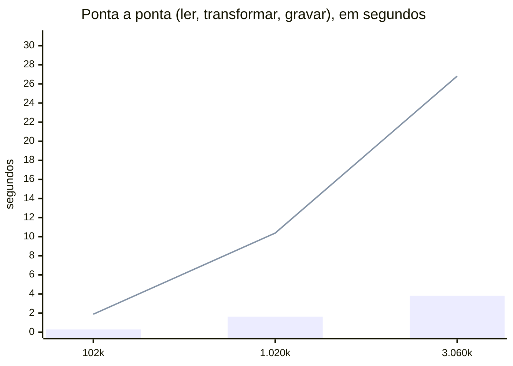

# Benchmark: pandas × PySpark

Executado em 28/10/2026, Spark local com 16 núcleo(s), mediana de 3 execuções. Dados sintéticos no formato do bronze real (2% de linhas repetidas para a deduplicação).

| Linhas no bronze | Cenário | pandas (s) | Spark (s) | pandas ÷ Spark |
| ---: | --- | ---: | ---: | ---: |
| 102.000 | ponta_a_ponta | 0.28 | 1.88 | 0.15× |
| 102.000 | busca_sem_particoes | 0.02 | 0.14 | 0.17× |
| 102.000 | busca_com_particoes | 0.01 | 0.24 | 0.04× |
| 1.020.000 | ponta_a_ponta | 1.62 | 10.38 | 0.16× |
| 1.020.000 | busca_sem_particoes | 0.01 | 0.11 | 0.12× |
| 1.020.000 | busca_com_particoes | 0.01 | 0.13 | 0.09× |
| 3.060.000 | ponta_a_ponta | 3.82 | 26.82 | 0.14× |
| 3.060.000 | busca_sem_particoes | 0.02 | 0.12 | 0.17× |
| 3.060.000 | busca_com_particoes | 0.03 | 0.17 | 0.15× |

**Ganho do particionamento** (buscar SP em janeiro de 2025):

| Linhas no bronze | Ferramenta | Sem partições (s) | Com partições (s) | Ganho |
| ---: | --- | ---: | ---: | ---: |
| 102.000 | pandas | 0.02 | 0.01 | 2.7× |
| 102.000 | spark | 0.14 | 0.24 | 0.6× |
| 1.020.000 | pandas | 0.01 | 0.01 | 1.1× |
| 1.020.000 | spark | 0.11 | 0.13 | 0.8× |
| 3.060.000 | pandas | 0.02 | 0.03 | 0.7× |
| 3.060.000 | spark | 0.12 | 0.17 | 0.7× |

Valores acima de 1× em "pandas ÷ Spark" significam que o Spark foi mais rápido.

Barras: pandas. Linha: Spark.
